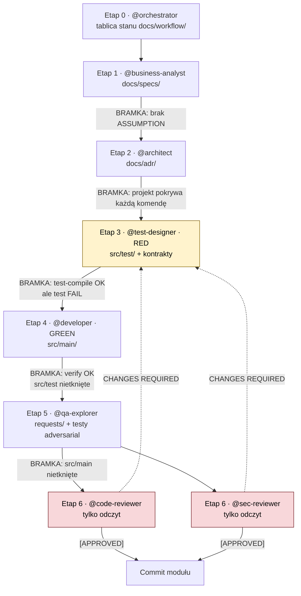

# AI SDLC — przepływ etapów i bramek

Diagram opisuje proces faktycznie zastosowany w tym repozytorium. Każdy etap wykonuje osobna
rola (osobny kontekst). Bramka to warunek, który orkiestrator sprawdza, zanim przekaże pracę dalej.

## Blokady zapisu (kto może co dotykać)

| Rola | Może pisać | Nie może pisać |
|---|---|---|
| `@business-analyst` | `docs/specs/` | kod, projekt |
| `@architect` | `docs/adr/` | kod, testy |
| `@test-designer` | `src/test/`, kontrakty w `src/main/` | logika biznesowa w `src/main/` |
| `@developer` | `src/main/` | `src/test/` (wyjątek: lista z `scripts/green-signature-allowlist.txt`) |
| `@qa-explorer` | `requests/`, nowe testy | `src/main/` |
| `@code-reviewer`, `@sec-reviewer` | nic | wszystko |

Blokady sprawdza `scripts/check-write-lock.sh red|green|qa`. Porównuje z ostatnim zatwierdzonym
punktem odniesienia, nie z dowolnym `HEAD`.

## Zasada powrotu

Gdy recenzja zwróci `CHANGES REQUIRED`, praca **wraca do etapu 3**, nie do etapu 4. Najpierw
powstaje czerwony test dla każdego znaleziska, dopiero potem poprawka. Test, który nie pada przed
poprawką, nie dowodzi poprawki.
