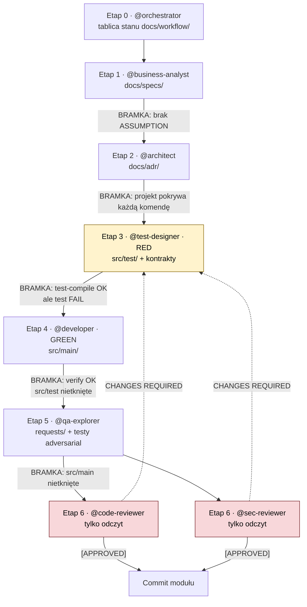

# AI SDLC — przepływ etapów i bramek

Diagram opisuje proces faktycznie zastosowany w tym repozytorium. Każdy etap wykonuje osobna
rola (osobny kontekst). Bramka to warunek, który orkiestrator sprawdza, zanim przekaże pracę dalej.

## Blokady zapisu (kto może co dotykać)

| Rola | Może pisać | Nie może pisać |
|---|---|---|
| `@business-analyst` | `docs/specs/` | kod, projekt |
| `@architect` | `docs/adr/` | kod, testy |
| `@test-designer` | `src/test/`, kontrakty w `src/main/` | logika biznesowa w `src/main/` |
| `@developer` | `src/main/` | `src/test/` (wyjątek: lista z `scripts/green-signature-allowlist.txt`) |
| `@qa-explorer` | `requests/`, nowe testy | `src/main/` |
| `@code-reviewer`, `@sec-reviewer` | nic | wszystko |

Blokady sprawdza `scripts/check-write-lock.sh red|green|qa`. Porównuje z ostatnim zatwierdzonym
punktem odniesienia, nie z dowolnym `HEAD`.

## Zasada powrotu

Gdy recenzja zwróci `CHANGES REQUIRED`, praca **wraca do etapu 3**, nie do etapu 4. Najpierw
powstaje czerwony test dla każdego znaleziska, dopiero potem poprawka. Test, który nie pada przed
poprawką, nie dowodzi poprawki.

---

# Description (English)

The process runs in eight stages. Each stage is done by a separate role in a fresh context, so
no role inherits the previous one's reasoning. A gate is a condition the orchestrator checks
before work moves on.

- **Stage 0, orchestrator.** Opens and maintains the state board in `docs/workflow/`. It routes
  work and checks every gate; it writes no code and no tests.
- **Stage 1, business analyst.** Writes the specification in `docs/specs/` as numbered business
  rules (`BR-xx`). Any business number it cannot trace to the product owner must be marked
  `ASSUMPTION`. **Gate:** no unresolved `ASSUMPTION` marker.
- **Stage 2, architect.** Writes the technical design in `docs/adr/`. **Gate:** the design covers
  every command in the specification.
- **Stage 3, test designer (RED).** Writes the contracts and the failing tests. Stubs return
  `null`. **Gate:** `test-compile` succeeds and `test` **fails**. A green run here means the
  tests check nothing.
- **Stage 4, developer (GREEN).** Implements `src/main/` until the tests pass. It may not edit
  tests. **Gate:** `verify` succeeds and `src/test/` is unchanged, checked by
  `scripts/check-write-lock.sh green`.
- **Stage 5, QA explorer.** Writes HTTP scenarios and adversarial tests. It may not patch
  production code. **Gate:** `src/main/` is unchanged.
- **Stage 6, code and security reviewers.** Read-only. Each returns `[APPROVED]` or
  `[CHANGES REQUIRED]`.

When a reviewer returns `CHANGES REQUIRED`, the work goes back to **stage 3**. A failing test is
written for each finding first, and only then is the code changed. A test that does not fail
before the fix does not prove the fix.

Write-lock rules are enforced by `scripts/check-write-lock.sh`, which compares against the last
reviewed commit, not against whatever `HEAD` happens to be.

---

# Opis (po polsku)

Proces składa się z ośmiu etapów. Każdy etap wykonuje osobna rola w świeżym kontekście, więc
żadna rola nie dziedziczy rozumowania poprzedniej. Bramka to warunek, który orkiestrator sprawdza,
zanim praca przejdzie dalej.

- **Etap 0, orkiestrator.** Prowadzi tablicę stanu w `docs/workflow/`. Kieruje pracą i sprawdza
  każdą bramkę; nie pisze kodu ani testów.
- **Etap 1, analityk biznesowy.** Pisze specyfikację w `docs/specs/` jako numerowane reguły
  biznesowe (`BR-xx`). Każdą liczbę biznesową, której nie da się przypisać do właściciela produktu,
  oznacza jako `ASSUMPTION`. **Bramka:** brak nierozstrzygniętych znaczników `ASSUMPTION`.
- **Etap 2, architekt.** Pisze projekt techniczny w `docs/adr/`. **Bramka:** projekt obejmuje
  każdą komendę ze specyfikacji.
- **Etap 3, test-designer (RED).** Pisze kontrakty i testy, które nie przechodzą. Stuby zwracają
  `null`. **Bramka:** `test-compile` przechodzi, a `test` **nie przechodzi**. Zielony wynik na tym
  etapie oznacza, że testy niczego nie sprawdzają.
- **Etap 4, programista (GREEN).** Implementuje `src/main/`, aż testy przejdą. Nie może zmieniać
  testów. **Bramka:** `verify` przechodzi, a `src/test/` jest nietknięte, co sprawdza
  `scripts/check-write-lock.sh green`.
- **Etap 5, tester QA.** Pisze scenariusze HTTP i testy adversarial. Nie może łatać kodu
  produkcyjnego. **Bramka:** `src/main/` jest nietknięte.
- **Etap 6, recenzenci kodu i bezpieczeństwa.** Tylko odczyt. Każdy zwraca `[APPROVED]` albo
  `[CHANGES REQUIRED]`.

Gdy recenzent zwróci `CHANGES REQUIRED`, praca wraca do **etapu 3**. Najpierw powstaje
nieprzechodzący test dla każdego znaleziska, dopiero potem zmiana kodu. Test, który nie pada przed
poprawką, nie dowodzi poprawki.

Reguły blokad zapisu egzekwuje `scripts/check-write-lock.sh`, który porównuje z ostatnim
zatwierdzonym punktem odniesienia, a nie z tym, co akurat jest w `HEAD`.
